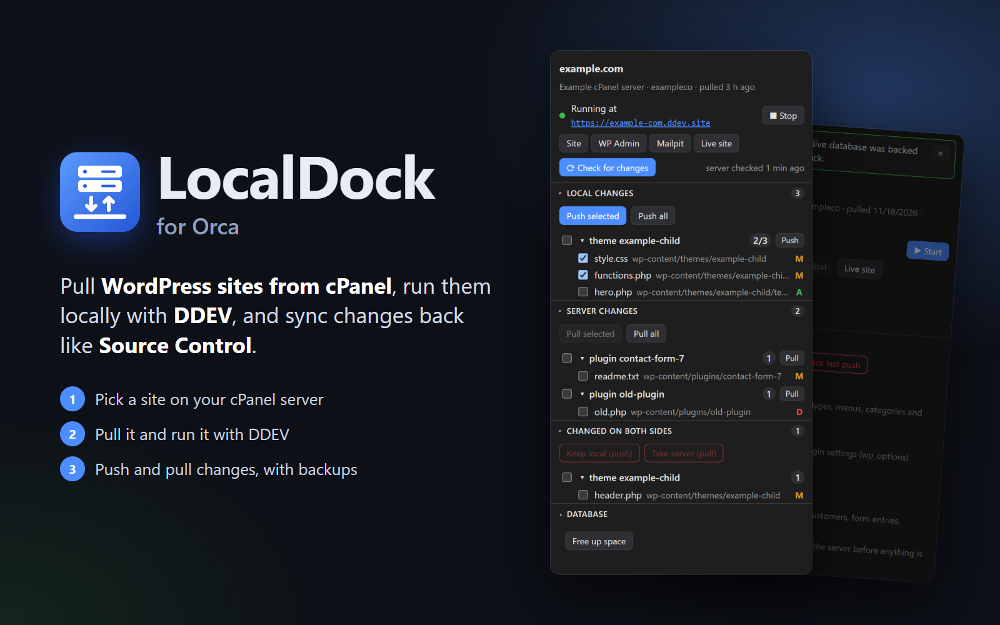
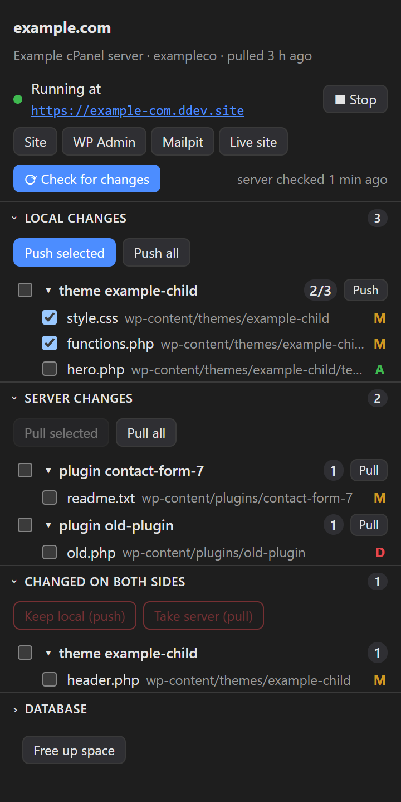
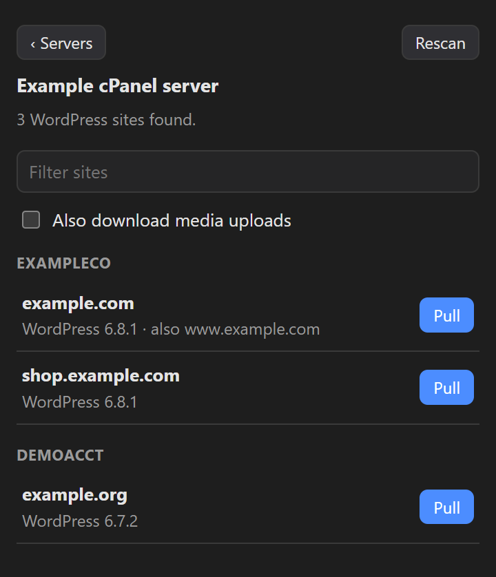
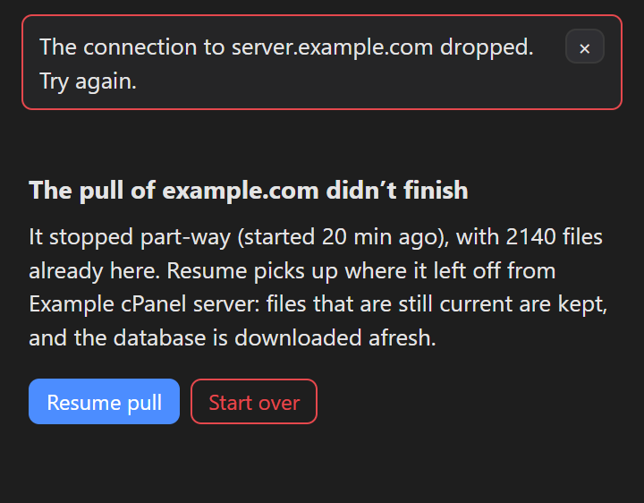
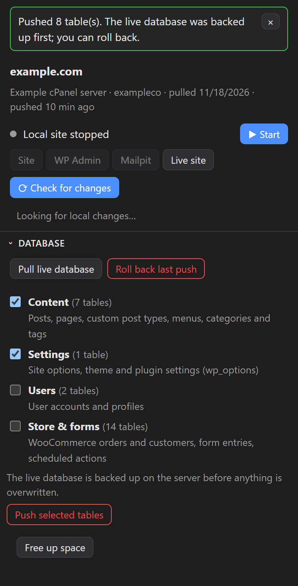

# LocalDock for Orca



> **🚧 Early version.** Everything works end to end, but it has been used on a small number of sites so far. Review what a push will change before you push to a live site.

**Local WP, but for cPanel, inside [Orca](https://github.com/stablyai/orca).** LocalDock is an Orca plugin that adds a **LocalDock** tab to the right sidebar, next to Source Control:

1. **Create a new, empty project** in Orca, open the LocalDock tab, and click **Use LocalDock in this project**. LocalDock leaves projects you don’t set up alone.
2. **Connect to a server.** LocalDock uses the hosts in your SSH config (`~/.ssh/config`), with the same keys, agent and `known_hosts` as `ssh` in a terminal. Add a `Host` that points at a cPanel server and connect to it once with `ssh <alias>`, so its key is trusted: log in as `root` to see every account on a WHM server, or as a cPanel account user to see that account's sites.
3. **Pick a WordPress site.** LocalDock scans the server (via cPanel's own `whmapi1`/`uapi`) and lists every WordPress install it finds.
4. **Pull it.** The site's files and database come down into the project, and **[DDEV](https://ddev.com)** runs it locally, with the same PHP and database versions as the server. Media (`wp-content/uploads`) stays on the server: the local site loads missing images from the live one. Files come down as compressed archives, several side by side, which helps a lot on a distant server. If a pull stops part-way (the connection drops, you cancel, Orca closes), the tab offers **Resume pull**: files that are still current are kept, and only the rest (and the database) are downloaded again.
5. **Work like Source Control.** Once a site is pulled, the tab stops listing server sites and becomes a sync view for this project:
   - **Local changes** you can push (edits by you or an AI agent in Orca).
   - **Server changes** you can pull (plugin updates, edits made in WP Admin).
   - **Changed on both sides**: flagged, never silently overwritten.
   - **Start / Stop** the local site, and open it, WP Admin or Mailpit in Orca's browser (the local URL is a link too). LocalDock starts Docker Desktop if needed, and offers to quit it and free disk space when no site is running.
   - **Database:** pull the live database, or push selected table groups (content, settings, …) with an automatic server-side backup and rollback.

A status bar item shows the site and its pending changes (↑ to push, ↓ to pull); click it to check the server.

Nothing is installed on your server, and LocalDock stores no server details: it reads your SSH config each time and trusts only the host keys in your `known_hosts`.

## Screenshots

<table>
  <tr>
    <td width="33%"></td>
    <td width="33%"><br><br></td>
    <td width="33%"></td>
  </tr>
  <tr>
    <td><b>Sync like Source Control.</b> Push or pull a file, a group or everything; files changed on both sides are flagged.</td>
    <td><b>Pick a site and pull it.</b> If the connection drops, resume where it stopped.</td>
    <td><b>Push the database</b> by table group, with a server-side backup and one-click rollback.</td>
  </tr>
</table>

Screenshots use made-up sample data (example.com). See [docs/media](docs/media/README.md) for how they're made.

## Install

### What you need

- [Orca](https://github.com/stablyai/orca) 1.4.248 or later, with plugins turned on (**Settings → Plugins**)
- [DDEV](https://ddev.com/get-started/) and the Docker it uses (Docker Desktop, OrbStack, Colima, …), to run sites locally. You can pull a site without them and start it later.
- OpenSSH: `ssh` and `ssh-keygen`, built into Windows 10 and later, macOS and Linux
- SSH access to a cPanel server, as root (sees every account on a WHM server) or as a cPanel account's own user (sees that account's sites). Jump hosts (`ProxyJump`) aren't supported yet.

### 1. Install the plugin

In Orca, open **Settings → Plugins**, choose **Add plugin → From a Git URL…**, paste `https://github.com/incompletebiped/orca-localdock` and choose **Install**. Or from a terminal:

```sh
orca plugin install incompletebiped/orca-localdock
```

Either way Orca installs the newest release and first shows what LocalDock asks for (see [Access it asks for](#access-it-asks-for)). In the terminal it prints the same command with `--approve <fingerprint>`; run that to install it. The plugin's page is [orca.dev/plugins/incompletebiped/orca-localdock](https://orca.dev/plugins/incompletebiped/orca-localdock). Later versions come with `orca plugin update incompletebiped.localdock`, and `orca plugin uninstall incompletebiped.localdock` removes it.

### 2. Add your server to your SSH config

LocalDock lists the `Host` entries in `~/.ssh/config` (`C:\Users\<you>\.ssh\config` on Windows). Add one for your server if it isn't there:

```
Host example-server
    HostName server.example.com
    User root
    IdentityFile ~/.ssh/id_ed25519
```

Then connect once in a terminal, so you can check the server's key and `ssh` saves it to `known_hosts`. LocalDock only trusts servers whose key is there:

```sh
ssh example-server
```

A key with a passphrase needs to be in your SSH agent (`ssh-add`).

### 3. Pull a site

1. Create a new, empty project in Orca and open it.
2. Open the **LocalDock** tab in the right sidebar and click **Use LocalDock in this project**.
3. Pick your server, then **Scan for sites**, then **Pull** next to the site you want.

The files and database come down into the project, and DDEV starts the site if it's installed. From then on the tab is the sync view for that project.

## Access it asks for

Orca asks you to approve this when you install LocalDock (`orca plugin inspect` shows the same):

| Orca permission | Why LocalDock needs it |
|---|---|
| **Runs its own code** in a separate Node.js process, with your user account's access (`trusted-worker`) | To run `ssh`, `ddev` and `docker`, and to read and write site files. Orca has no narrower permission for that. |
| **Read your projects and workspaces** (`workspace:read`) | To follow the project you focus and find its folder. LocalDock only acts in projects you set up with it. |
| **Show desktop notifications** (`notifications:show`) | To say when a pull finishes. |
| **Store data in its own storage folder** (`storage:own`) | To remember host names and which server, account and folder each pulled site came from (see [SECURITY.md](SECURITY.md)). |

It adds the **LocalDock** sidebar tab, four commands (**Refresh**, **Check for changes**, **Start local site**, **Stop local site**) and a status bar item.

What it does with that access:

- **On this computer** it reads `~/.ssh/config` (through `ssh -G`), `known_hosts` (through `ssh-keygen -F`) and the identity files `ssh` would use, which stay in memory for the connection only. It runs `ssh`, `ssh-keygen`, `ddev` and `docker` (to start and quit Docker Desktop, and to remove old DDEV images when you ask). On Windows it also runs `wsl` to make the project's drive visible to Docker, and Orca's own `orca` command to open links in Orca's browser. Programs are found only in your PATH's absolute folders, never in the project folder.
- **It writes** only to the project folder you pulled into (the site's files, `.localdock/`, `.ddev/`, a local `wp-config.php` and two small local-only helper files) and to its own storage in Orca.
- **On your server** it lists cPanel accounts and domains, reads and writes files in the docroot of the site you pulled, dumps and imports that site's database, keeps a backup in `~/.localdock-backups/` before each database push, and writes a short-lived MySQL option file to `~/.localdock-tmp/` while a database step runs. It installs nothing there. [SECURITY.md](SECURITY.md) has the details.
- **Network:** only SSH, to the servers you pick. No telemetry, and the panel itself has no network access.
- **Never:** it doesn't store passwords, download production's `wp-config.php`, or add or change `known_hosts` entries.

## Status

| Part | State |
|---|---|
| Sync engine (`packages/core`): cPanel discovery, three-way change detection, file push/pull, database pull/push with backups, DDEV control | ✅ Built and unit-tested |
| Sidebar panel UI (`packages/orca-plugin/src/panel`): every screen from "connect a server" to the source-control view | ✅ Built; viewable in a browser preview with sample data |
| Plugin worker (`packages/orca-plugin/src/worker`): state machine wiring the panel to the engine | ✅ Built and unit-tested |
| Panel ↔ worker messaging (`plugin.request`, `panels.post`) | ✅ Working in Orca |
| The open project's folder (`workspace.readContext` + `workspace.list`) | ✅ Working in Orca |
| Opening the site, WP Admin and Mailpit in Orca's browser (via Orca's CLI; default browser as a fallback) | ✅ Working in Orca |
| Status bar item | ✅ Working in Orca |
| Servers over SSH, through your own SSH config (`ssh -G`, your keys and agent, `known_hosts`) | ✅ Working |
| Resuming an interrupted pull; a dropped connection fails the step instead of hanging | ✅ Working |

Orca doesn't share its own SSH hosts with plugins yet, which is why LocalDock reads your SSH config instead. See **[docs/ORCA-GAPS.md](docs/ORCA-GAPS.md)** for what LocalDock uses from Orca and what it's still missing, and the roadmap below for what changes once it can.

## Roadmap: using Orca's SSH hosts

Today LocalDock only sees servers in `~/.ssh/config`. Orca has its own SSH hosts (**Settings → SSH**), but plugins can't use them yet. If Orca opens them to plugins (listing the hosts, and running commands and transferring files over Orca's connection), LocalDock would switch to them:

- [ ] **Servers set up in Orca show up in LocalDock.** Add a server once in Orca's settings and pull from it; no `~/.ssh/config` entry, and nothing to keep in sync between the two.
- [ ] **Orca handles logging in.** Keys, passphrases and new host keys would go through Orca's own prompts, so there's no "connect once with `ssh` in a terminal" step, and passphrase-protected keys work without an agent. LocalDock would never read a key file itself.
- [ ] **Jump hosts.** Servers behind a bastion (`ProxyJump`) would work wherever Orca's connection does.
- [ ] **One connection, kept alive by Orca.** LocalDock would share Orca's connection to a server (the one its remote projects and terminals use) instead of logging in again, and Orca would reconnect after sleep or a network change.
- [ ] **Sites tied to Orca's host id, not an alias name.** Renaming a `Host` alias wouldn't strand a pulled site.
- [ ] **The same speed.** Parallel archive downloads and resumable pulls stay, as long as Orca's connection can run several commands at once.

Only the host layer would change (`PluginOrcaHost.listSshHosts()`, `findSshHost()` and `openSession()` in `packages/orca-plugin/src/worker/orca/pluginHost.ts`). The SSH config would stay as a fallback for servers that aren't in Orca.

## Try the panel

The panel can be previewed in a normal browser with sample data:

```sh
npm install
npm run preview      # builds packages/orca-plugin/preview/index.html
```

Open `packages/orca-plugin/preview/index.html` and switch between states with the menu at the top.

## Load it in Orca (for development)

The repository root is the plugin folder: `orca-plugin.json` there names the built worker and panel in `plugin/`, which are committed, because installs from Git run no build. After changing the source, rebuild and commit `plugin/` with it (CI checks that it matches):

```sh
npm install
npm run build        # builds plugin/worker.mjs and plugin/panel/index.html
```

Load the repository as a development plugin, either in Orca (**Settings → Plugins → Development folders…**) or from a terminal. Uninstall the released version first, or disable one of the two:

```sh
orca plugin dev load .                 # prints the approval command to run next
orca plugin logs local.localdock       # what the worker printed
orca plugin dev request . state        # call the worker as the panel does
```

The LocalDock tab appears in the right sidebar and follows the project you focus. Create a new, empty project, focus it, and click **Use LocalDock in this project**.

## Clear a pulled site out of a project

An unfinished pull can be cleared from the tab (**Start over**). To clear a finished pull, or from a terminal:

```sh
npm run reset-project -- <project folder>         # shows what would be deleted
npm run reset-project -- <project folder> --yes   # deletes it
```

It deletes the site's DDEV project (containers and database) and every file except `.git` and the other files a new project starts with. It refuses folders without a `.localdock` folder.

## Repository layout

```
orca-plugin.json        the plugin manifest (the repository root is the plugin folder)
plugin/                 the built worker and panel Orca runs (committed; made by npm run build)
packages/core/          sync engine, independent of Orca (TypeScript, tested)
packages/orca-plugin/   the plugin's source: worker, sidebar panel, preview, build script
docs/media/             icon, cover, screenshots and how they're made
docs/ORCA-GAPS.md       which Orca APIs LocalDock uses, what Orca still needs to add, and where each gap lives
docs/ARCHITECTURE.md    how the pieces fit together
```

## Security & privacy

LocalDock acts with your SSH access to production servers. See [SECURITY.md](SECURITY.md) for what it does on a server and how risks are handled. In short:

- It never downloads production's `wp-config.php` (credentials and salts stay on the server). Database passwords are read on demand and never stored.
- Panel input is validated and every server-supplied string is escaped.
- Pushes re-check the server first, and database pushes take a backup.
- No telemetry.

## Lineage

A rewrite of [cursor-extension-localdock](https://github.com/incompletebiped/cursor-extension-localdock), a VS Code/Cursor extension with the same goal.

## License

[MIT](LICENSE)
